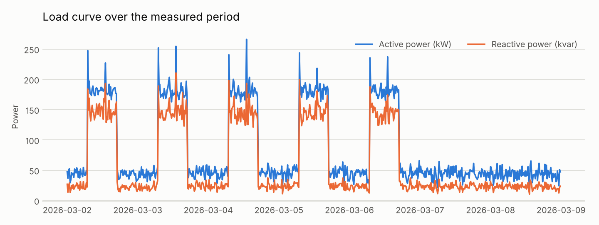
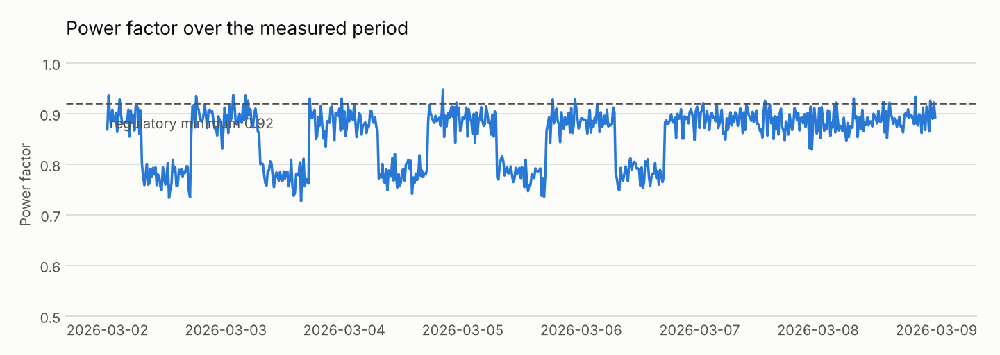
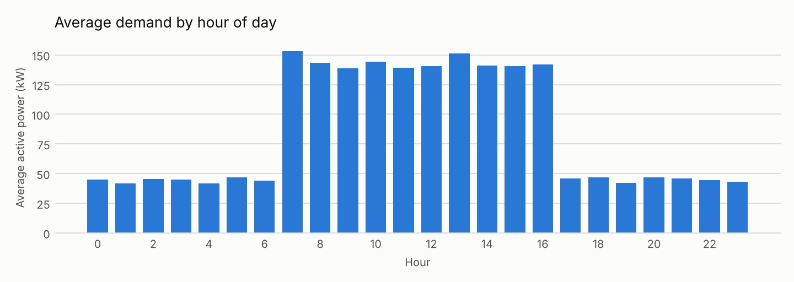

# Power quality report

**Measured period:** 2026-03-02 00:00 to 2026-03-08 23:45 (7.0 days, 15 min integration)

## Indicators

| Indicator | Value |
| --- | --- |
| Active energy | 14,418 kWh |
| Reactive energy | 10,081 kvarh |
| Peak demand | 266.0 kW |
| Average demand | 85.8 kW |
| Load factor | 0.32 |
| Average power factor | 0.820 |
| Hours with PF below 0.92 | 162 h |
| Average voltage | 219.1 V |
| Peak voltage unbalance | 1.91 % |
| Peak voltage THD | 5.68 % |
| Current THD, average / peak | 9.25 % / 20.86 % |
| Estimated transformer K-factor | 1.8 |
| Estimated energy cost for the period | BRL 8,939.19 |

## Power factor correction

Raising the power factor to the 0.95 target at the heaviest load band requires a capacitor bank of **93 kvar**.

Sizing uses the mean of the top decile of the load curve, which is the critical condition. An automatic stepped bank is recommended to avoid overcorrection during light load periods.

## Findings

- Average power factor of 0.820, below the 0.92 minimum. 162 h of the measurement are non-compliant and subject to excess reactive energy charges.

## Charts

---

Report generated automatically by `power_quality.py`.
