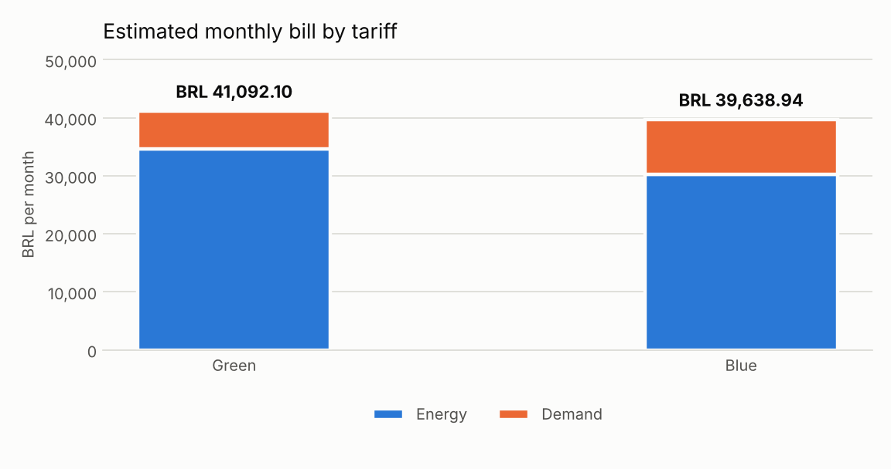

# Tariff study

**Basis:** 7.0 days of measurement, projected to a 30-day month.
**Utility:** Example Utility · **Subgroup:** A4 · **Tariffs effective:** 2026
**Peak window:** 18:00 to 21:00, weekdays only.

## Energy and demand by window

| Quantity | Peak | Off-peak |
| --- | --- | --- |
| Projected monthly energy | 2,919 kWh | 58,964 kWh |
| Recorded peak demand | 61.8 kW | 266.0 kW |

## Tariff comparison

| Component | Green | Blue |
| --- | --- | --- |
| Energy | BRL 34,662.88 | BRL 30,188.91 |
| Demand | BRL 6,429.22 | BRL 9,450.03 |
| Overrun penalty | BRL 0.00 | BRL 0.00 |
| **Monthly total** | **BRL 41,092.10** | **BRL 39,638.94** |

## Cheapest contracted demand

- **Green:** 254 kW (single contract).
- **Blue:** 59 kW at peak and 254 kW off-peak.

The search sweeps the possible contracted demands and keeps the cheapest total, taking into account that the overrun penalty only applies above 5% of the contracted value, at 2× the demand tariff.

## Conclusion

The **Blue** tariff is the better fit for this load profile, with an estimated saving of **BRL 1,453.16 per month** (BRL 17,437.88 per year) against the Green tariff.

## Chart

---

Study generated automatically by `tariff_study.py`. Tariffs are read from `config/tariffs.json` and must be kept in line with the utility's current tariff resolution.
